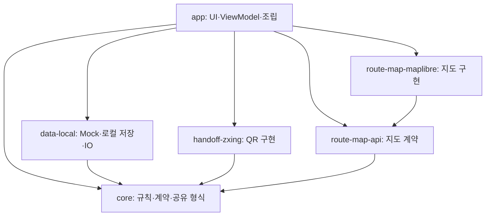

# MVP 아키텍처 — 0.6

운행 선택·정산·지도·휴대폰 전달을 완료하는 Mock MVP가 첫 커밋의 기준입니다. 실제 Trip/GPS 이력, 차량 기본값·실시간 가격, 앱 내부 순정 지도는 지원 확인 후 연결합니다.

## 책임과 모듈 방향

| 계층 | 책임 | 의존하지 않는 대상 |
| --- | --- | --- |
| core/domain | 정산·금액 배분, 초안/참가자/단가 변경 규칙, Repository/저장 계약 | Android, UI, 구현 모듈, 외부 SDK |
| core/format | 원화·거리·공유 요약 텍스트 | Android, SDK |
| core/handoff | QR 인코더와 중립 QR 매트릭스 계약 | ZXing, Android |
| data-local | Mock 기록·기본값, 경로 자산, JSON·초안 저장, IO 전환 | UI, 지도/QR 구현 |
| handoff-zxing | QR 라이브러리 변환, CPU 전환 | Android, 앱 UI, 데이터 구현 |
| route-map-api | 지도 화면/세션·표시 모델·상태·출처 계약 | 특정 지도 SDK, Compose |
| route-map-maplibre | 실제 MapView·카메라·스타일·HTTP·수명주기 | 앱 UI, 데이터 구현 |
| app | Compose UI, 화면 상태/전환, 저장 조율, Android 주행 제한/공유 동작 | UI에서 구체 데이터·지도·QR 구현 직접 사용 금지 |

Application이 데이터/지도/QR 구현을 선택하고 계약으로 주입합니다. Activity는 주행 제한과 Android 수명주기를 연결합니다. ViewModel에 Context, MapView, ZXing 타입을 두지 않습니다. 교체 요구가 없는 동작까지 인터페이스로 늘리지 않습니다.

## ViewModel과 데이터 수명주기

ViewModel은 화면 전환·운행 선택·상태 발행·저장 조율을 담당합니다. 참가자 수/부분 참여 유지와 단가 출처 변경은 `DraftEditor`, 정산 표시 데이터 평가는 `SettlementPreview`에 위임합니다. 화면 상태는 `DriveUiState`에 두며 ViewModel은 시연 데이터를 갖지 않습니다. 저장된 초안은 첫 로드에서만 `restoreDraftOnce()`로 복원합니다.

UI와 도메인이 함께 쓰는 제한값과 판정은 `core/domain/SettlementRules.kt` 한 곳에 둡니다. 금액 한도(`MAX_MONEY_WON`, `MAX_EXPENSE_WON`), 인원 범위(`MIN_PARTICIPANTS`~`MAX_PARTICIPANTS`), 연료비 비용 ID(`ENERGY_COST_ID`), 참가자 이름 중복 판정(`participantNameKey`, `isInvalidParticipantName`)입니다. 화면에서 같은 숫자나 규칙을 다시 쓰지 않습니다. 계산 기준 변경 폼은 `DraftEditor.previewCostSettings`로 미리보기와 검증을 하고, ViewModel은 같은 규칙의 `applyCostSettings`로 반영합니다. 폼의 단가 출처 안내와 실제 저장값이 어긋나지 않게 하기 위해서입니다.

UI 계층에는 Mock 데이터에 맞춘 날짜·ID를 두지 않습니다. 운행 목록 필터는 데이터에 독립적인 전체/선택한 운행만 제공하고, 날짜 묶음 선택은 Repository가 준 운행의 날짜로 만듭니다.

Repository/초안 저장은 Main에서 호출할 수 있는 suspend 계약입니다. Mock 경로 파일과 JSON 읽기·쓰기, SharedPreferences 디스크 쓰기는 데이터 구현이 IO dispatcher로 전환합니다. 초안은 UI에 즉시 반영하고 단일 큐에서 순서대로 저장합니다. 저장 구현은 commit 결과를 확인하며 실패 시 입력을 유지하고 안내합니다. 비동기 저장이므로 프로세스 강제 종료 직전의 미완료 저장을 보장하지 않습니다.

초안 JSON 버전 1과 기존 ID/금액/부분 참여를 유지합니다. 복원은 데이터 로드에 앞서 비동기로 수행합니다. 로드 재시도는 진행 중인 로드를 취소하고, 이미 편집한 초안을 다시 디스크 값으로 덮어쓰지 않습니다. SDK/IO/QR 코루틴 취소를 일반 실패로 바꾸지 않습니다.

## 지도와 QR 계약

`RouteMapProvider`는 출처와 화면별 `RouteMapSession` 생성만 제공합니다. 세션은 View·네이티브 자원을 소유하며 입력은 좌표·선택/확인 상태·카메라 범위·Pleos 테마입니다. 출력은 일반 View, Loading/Ready/NoRoute/Failed 상태와 확인한 운행 ID입니다. 정산 초안·참가자·금액을 받지 않습니다. 화면/주행 제한으로 지도가 사라지면 공통 호스트가 lifecycle/메모리 구독을 해제하고 구현체가 SDK 자원을 닫습니다. close는 반복 호출에 안전하며 해제/이전 스타일 요청의 늦은 콜백은 무시합니다.

`QrEncoder`는 정산 요약 문자열을 중립 QR 모듈 매트릭스로 반환합니다. CPU 전환은 구현체가 담당하고 화면은 크기와 픽셀만 사용합니다. QR 생성과 지도 표시가 정산 금액을 변경하지 않습니다.

## SDK 지원 후 교체

| 지원 기능 | 교체 지점 | 유지하는 코드 |
| --- | --- | --- |
| 과거 운행·GPS 이력 | 새 데이터 어댑터의 TripRepository + Application 바인딩 | 선택 UX, 지도 계약, 계산 |
| 차량 연료 종류·가격 | DriveDefaultsRepository 구현 + 바인딩 | 비용 편집·계산·단가 출처 보존 |
| 앱 내부 순정 지도·다중 경로 | 새 지도 어댑터의 RouteMapProvider/Session + 바인딩 | 데이터 Repository, 공통 지도 조작 UI, 계산 |
| QR 라이브러리 변경 | QrEncoder 구현 + 바인딩 | 결과 화면, 요약 문구, 계산 |

SDK 의존성·권한·초기화는 새 구현 모듈 안에 두고 루트 아키텍처 허용 규칙에 등록합니다. 현재 Pleos 지도 어댑터나 미지원 API를 가정한 구현은 없습니다. 외부 순정 앱 실행만으로 앱 내부 지도 계약을 만족한다고 볼 수 없습니다.

실제 데이터는 안정된 Trip ID, 시간대, 정수 m, 소비량 L/kWh, null 의미, 위·경도 순서와 GPS 단절을 정규화해야 합니다. 과거 이력을 예상 경로로 가장하지 않습니다. 현재 지도 표시 좌표는 Web Mercator 범위(위도 ±85°)이며 손상/누락 경로를 직선으로 보정하지 않습니다. 거리는 기록 값을 사용하고 지도 선 길이로 재계산하지 않습니다. 별도 상세 조회·페이지·실시간 구독만 제공되는 SDK라면 데이터 계약을 그 요구에 맞게 확장해야 합니다. SDK가 현재 계약을 만족하는지는 실제 지원 확인과 검증이 필요합니다.

## 구조 검사와 테스트

`./scripts/check.sh`가 모듈 방향·금지된 구현 참조·SDK 의존성 위치를 검사하고 전체 단위 테스트·APK 빌드·Android 모듈 Lint를 실행합니다. 앱 preBuild와 모듈 check에도 구조 검사를 연결했습니다. core와 QR 구현 테스트는 Android 없이 일반 JVM에서 실행합니다. 테스트에서 시계·ID·dispatcher·Repository/저장 계약을 대체할 수 있습니다.

초기 기준 테스트는 금액 합계, 3/4/5인·부분 참여, 수동 단가 출처, 단가 폼 미리보기/적용 차이, 인원 한도, 대소문자·공백만 다른 이름, 참가자 축소, 비동기 읽기·저장 순서/실패, IO 실행 위치, QR 한글 왕복, 다중 경로 범위를 검증합니다. 실제 UI·주행 제한은 에뮬레이터에서 별도로 검증합니다. 세부 결과는 [VERIFICATION.md](VERIFICATION.md)에 기록합니다.
